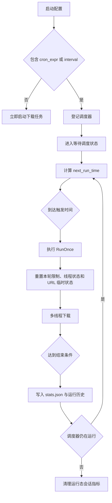
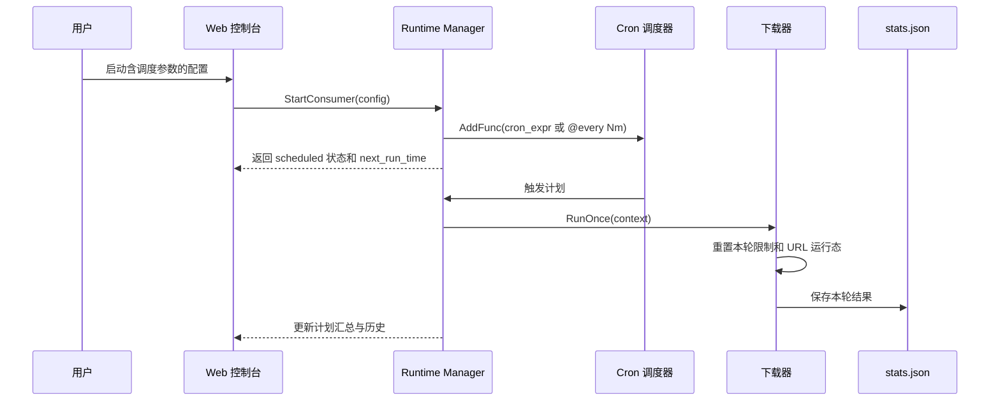
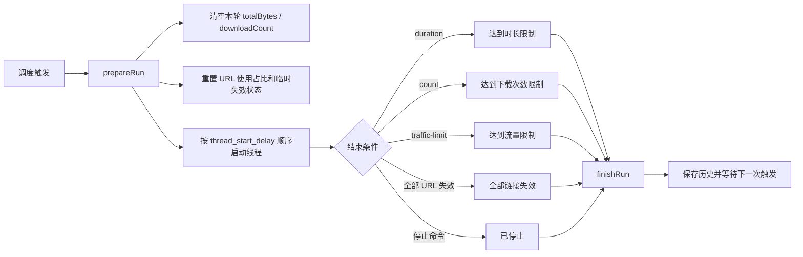

# Traffic Consumer

多线程流量消耗器，可在命令行或 Web UI 中批量拉流、限速、调度并生成统计报告，适合 CDN 验证、带宽压测和专线巡检等场景。

---
## 禁止恶意刷他人流量
## 禁止恶意刷他人流量
## 禁止恶意刷他人流量
## 造成的后果与本仓库作者无关


## 🧭 快速导航

1. [亮点功能](#-亮点功能)
2. [安装与启动](#-安装与启动)
3. [运行方式](#-运行方式)
4. [配置与自动化](#-配置与自动化)
5. [调度逻辑](#-调度逻辑)
6. [运行数据、日志与接口](#-运行数据日志与接口)
7. [命令行速查](#-命令行速查)
8. [目录结构](#-目录结构)
9. [开发与测试](#-开发与测试)
10. [常见问题](#-常见问题)

---

## ✨ 亮点功能

- **双运行模式**：默认 Web 控制台，可一键切换 `--no-gui` 进入 CLI。
- **多线程拉流**：可配置并发数、限速、次数、时长、流量上限等条件。
- **URL 策略与治理**：支持随机/轮询，记录每条 URL 的使用占比，可选择“失败自动移除”防止坏链污染配置。
- **请求头支持**：可自定义 `User-Agent` 与额外请求头，适配需要鉴权或防爬限制的资源。
- **更稳的调度控制**：支持 Cron/固定间隔、重叠触发保护、计划停止、配置删除联动，并避免空配置回退到默认测试 URL。
- **实时可视化**：速度曲线、线程状态、URL 饼图、HTTP 轮询日志、调度倒计时全部集中显示。
- **调度自动化**：Cron 与固定间隔二选一，带未来触发预览、Web 自启动恢复和单击停止。
- **临时测试入口**：可对当前选中的配置直接发起一次最多 100MB 的链路验证，不受调度等待影响。
- **持久化存储**：配置与统计写入 `~/.traffic_consumer/`，Web/CLI 共享；也可通过 `TRAFFIC_CONSUMER_CONFIG_DIR` 自定义目录。
- **跨平台交付**：提供 Docker 镜像、Go 单文件可执行产物与 GitHub Actions 工作流。


---

## 🚀 安装与启动

### Docker（推荐）

```bash
docker pull baitaotao521/traffic_consumer:latest

docker run -d \
  -p 5001:5001 \
  -v $HOME/.traffic_consumer_data:/root/.traffic_consumer \
  --name traffic_consumer \
  baitaotao521/traffic_consumer:latest
```

- 访问 `http://宿主机IP:5001` 使用 Web 控制台。
- `-v` 将配置与历史写入宿主机，容器删掉也不丢数据。
- 若需显式指定数据目录，可设置环境变量 `TRAFFIC_CONSUMER_CONFIG_DIR=/root/.traffic_consumer`。
- CLI 模式：`docker run --rm ... baitaotao521/traffic_consumer:latest --no-gui --limit 5`

常用命令：

```bash
docker logs -f traffic_consumer
docker stop/start traffic_consumer
docker rm traffic_consumer
```

### 本地运行

```bash
git clone https://github.com/baitaotao521/traffic_consumer.git
cd traffic_consumer
npm --prefix frontend ci
npm --prefix frontend run build
go run .          # Web UI
go run . --no-gui # CLI
```

---

## 🧩 运行方式

### Web 控制台

- **仪表盘**：实时显示速度、总下载量、线程状态以及当前运行配置。
- **可视化**：Unovis 绘制速度折线、线程饼图、URL 占比，并同步线程表格。
- **配置编辑器**：图形化维护 URL 列表、线程数、限速条件、调度参数以及“失败自动移除”开关。
- **调度中心**：查看下一次执行时间、倒计时、运行计划和最近 50 条历史，支持一键停止调度。
- **临时测试**：在不启动 Cron/间隔调度的前提下，对当前配置执行一次最多 100MB 的快速验证。
- **实时日志**：按需通过 HTTP 轮询读取日志，前端负责渲染颜色，避免 ANSI 乱码。
- **失效告警**：URL 连续失败达到阈值后触发通知，并可自动从运行实例/配置文件移除。

### 命令行

```bash
go run . \
  --no-gui \
  --urls https://example.com/a.bin https://example.com/b.bin \
  --threads 8 \
  --limit 10 \
  --traffic-limit 2048 \
  --auto-remove-failed-url \
  --user-agent "Mozilla/5.0 ..." \
  --header "Referer: https://example.com" \
  --headers-json '{"Origin":"https://example.com"}' \
  --url-switch-interval 30 \
  --thread-start-delay 0.5
```

- 适合嵌入 CI 或远程主机。
- 使用 `--save-config/--load-config` 管理持久化配置；`--show-stats` 快速查看历史。
- 按 `Ctrl+C` 可随时停止，历史与统计仍会写入本地。

---

## ⚙️ 配置与自动化

| 项目 | 说明 |
| --- | --- |
| 数据目录 | 默认 `~/.traffic_consumer/`，可通过 `TRAFFIC_CONSUMER_CONFIG_DIR` 指定 |
| `config.json` | 所有命名配置；Web/CLI 共用，支持保存、加载、重命名、删除和列举 |
| `stats.json` | 每次运行的总流量、次数、时间线、结束原因和 URL 使用情况 |
| `auto_start` | Web 服务启动时恢复该配置；带调度参数进入等待调度，不带调度参数立即下载 |
| 失败链接自动移除 | URL 重试耗尽后从运行实例和配置文件剔除，后续调度轮次使用更新后的 URL 列表 |
| 调度来源 | 推荐 `cron_expr` 和 `interval` 二选一；Web 保存和启动会拒绝二者同时存在，CLI 同时存在时按 Cron 执行 |
| 显式空 URL | 保存为空数组时视为主动禁用下载链接，不会回退到内置测试 URL |

常见保存方式：

```bash
# 保存一个 Web 服务启动后自动恢复的间隔计划
go run . \
  --save-config \
  --config cdn-nightly \
  --urls https://example.com/a.bin https://example.com/b.bin \
  --threads 8 \
  --traffic-limit 2048 \
  --interval 60 \
  --auto-start

# 读取保存的配置，在 CLI 中按配置内 interval 等待触发
go run . --no-gui --load-config --config cdn-nightly

# 不保存配置，直接在 CLI 中等待 Cron 触发
go run . \
  --no-gui \
  --urls https://example.com/a.bin \
  --threads 8 \
  --traffic-limit 2048 \
  --cron "0 * * * *"
```

---

## ⏱ 调度逻辑

### 调度总览



### 触发模型

- Cron 使用五段表达式，由 `robfig/cron` 标准解析器校验；Web 的 Cron 预览会返回接下来 5 次触发时间。
- 固定间隔使用分钟数，内部注册为 `@every Nm`，从调度器登记时间开始计算，不按整点或整分钟对齐。
- Web 保存和启动会强制 Cron 与固定间隔互斥；CLI 同时拿到两者时按 Cron 执行。
- 同一个配置同一时间只能有一个下载实例或等待调度实例。
- Web 与 CLI 调度器都使用 `Asia/Shanghai` 时区；系统缺少该时区数据时回退到本地时区。
- 同一计划开启重叠保护：上一轮尚未结束时，下一次触发不会并发启动第二轮。

### Web 模式



- 点击启动时，配置包含 `cron_expr` 或 `interval` 会进入“等待调度”状态，不会立即下载。
- Dashboard 通过运行计划展示 `scheduler_running`、`next_run_time`、本次任务会话累计流量和最近运行结果。
- `auto_start` 配置会在 Web 服务启动时恢复；调度配置恢复为等待调度，普通配置恢复为立即下载。
- 临时测试会暂停同名等待计划，移除调度参数后执行一次最多 100 MB 的验证；测试自然结束后恢复原计划。
- 停止临时测试或停止调度器会取消待恢复计划，不会在清理完成后偷偷重新登记。

### CLI 模式

- `--no-gui` 搭配 `--cron` 或 `--interval` 会进入调度等待，不再启动 Web UI。
- CLI 会打印下一次执行时间和倒计时，按 `Ctrl+C` 停止调度器并取消正在执行的调度轮次。
- `--load-config` 会先加载指定配置，再用命令行显式传入的字段补齐空字段；保存过空 URL 的配置不会自动使用默认测试链接。

### 每轮执行边界



- 每次触发都会调用同一套下载流程，重新计算 `duration`、`count`、`traffic-limit`、线程状态、URL 临时失效状态和 URL 使用占比。
- 每轮结束都会写入 `stats.json`，结束原因包括成功、达到时长限制、达到下载次数限制、达到流量限制、全部链接失效和已停止。
- 等待下一次触发时，Web 计划行会保留当前任务会话内已完成轮次的累计流量和次数；停止计划后这些会话指标清零，历史记录仍保留。
- 保存、重命名或删除配置会先停止同名运行态；这能避免旧调度继续拿着已经过期的配置快照运行。这个坑不写清楚，排查起来真的很浪费生命。

---

## 📡 运行数据、日志与接口

- Web 控制台默认监听 `0.0.0.0:5001`，页面访问 `http://127.0.0.1:5001` 或宿主机 IP。
- Dashboard 主数据来自 `GET /api/dashboard`，包含配置列表、运行状态、调度摘要和计划列表。
- 日志和通知来自 `GET /api/activity` 增量轮询，可按 `scheduler`、`runtime`、`download` 来源筛选。
- 计划详情来自 `GET /api/plans/{name}`，返回配置快照、当前计划汇总和最近 50 条历史。
- Cron 预览来自 `POST /api/cron/preview`，OpenAPI 合同位于 `GET /api/openapi.json`。
- 前端 SDK 由 `npm --prefix frontend run api:generate` 生成，后端 API 字段变化后必须同步更新。

---

## 🧰 命令行速查

| 参数 | 含义 | 默认值 |
| --- | --- | --- |
| `-u, --urls` | 多个下载 URL | 内置测试 URL |
| `--url-strategy` | `random` / `round_robin` | `random` |
| `-t, --threads` | 下载线程数 | `8` |
| `-l, --limit` | 限速（MB/s，0 表示不限） | `0` |
| `-d, --duration` | 运行时长（秒） | 无限制 |
| `-c, --count` | 下载次数 | 无限制 |
| `--traffic-limit` | 总流量上限（MB） | 无限制 |
| `--cron` / `--interval` | 定时任务（推荐二选一；同时存在时 Cron 优先） | 不启用 |
| `--auto-remove-failed-url` | URL 连续失败后自动从配置中删除 | 关闭 |
| `--auto-start` | 保存配置时标记 Web 服务启动后自动恢复 | 关闭 |
| `--user-agent` | 自定义 `User-Agent` | 无 |
| `--header` / `--headers-json` | 自定义请求头 | 无 |
| `--url-switch-interval` | 单条 URL 连续下载后强制切换（秒） | 不启用 |
| `--thread-start-delay` | 多线程顺序启动间隔（秒） | `0` |
| `--config` | 指定配置名，并配合 `--load-config/--save-config` | `default` |
| `--show-stats` | 打印最近 N 条历史（配合 `--stats-limit`） | 关闭 |
| `--no-gui` | 禁用 Web UI，仅运行 CLI | 关闭 |

完整参数可执行 `go run . --help` 查看。

---

## 🗂 目录结构

```
├── main.go                 # Go 入口，默认 Web UI，--no-gui 进入 CLI
├── internal/
│   ├── cli/                # 命令行解析与入口
│   ├── consumer/           # 核心业务：下载、限速、重试、统计
│   ├── httpapi/            # HTTP 页面与 JSON API
│   ├── runtime/            # Web 运行态、调度、日志与事件缓冲
│   ├── storage/            # 配置/统计 JSON 读写
│   ├── stats/              # 统计聚合与格式化
│   └── urlmanager/         # URL 分配、权重与失效治理
├── frontend/               # Vue/Vite + shadcn-vue 前端源码与 dist 产物
├── go.mod                  # Go module
├── scripts/package.sh      # 本地与 GitHub Actions 共用的发布打包脚本
├── Dockerfile              # 镜像构建
└── .github/workflows/      # CI/CD
```

---

## 🛠 开发与测试

1. 安装 Go 1.26、Node.js 22 或更新版本。
2. 修改前端后运行 `npm --prefix frontend ci` 和 `npm --prefix frontend run build`，产物写入 `frontend/dist`。
3. 修改核心逻辑后运行 `go fmt ./...` 和 `go test ./...`。
4. 本地打包执行 `scripts/package.sh`，一次性生成三个平台执行 `scripts/package.sh --all`。
5. GitHub Actions（`.github/workflows/build-simple.yml`）会在 push/tag 时自动校验前端与 Go 构建，并调用同一脚本生成发布包。

---

## ❓ 常见问题

| 问题 | 解决方案 |
| --- | --- |
| 启动后没看到 CLI | 默认进入 Web UI，请添加 `--no-gui` |
| 速度为 0 或线程空闲 | 检查 URL 是否有效、是否已达到次数/流量限制 |
| Cron 表达式报错 | 使用 Web UI 内置预览工具验证语法，再保存 |
| 日志太多导致浏览器卡顿 | Web UI 日志轮询默认关闭，开启后可点击“清空” |
| 定时任务第二次无限制运行 | 现已在每轮运行前重置限流/计数状态，确保限制生效 |

---

## 🤝 贡献与协议

欢迎提交 Issue / PR，共同完善项目：

1. Fork 仓库并创建特性分支：`git checkout -b feat/my-feature`
2. 遵循 Conventional Commits 书写提交信息
3. 更新文档/截图/测试并在 PR 描述中写明动机与验证

项目以 **MIT License** 发布，可自由使用与二次开发。
