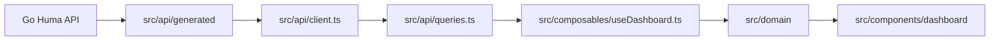
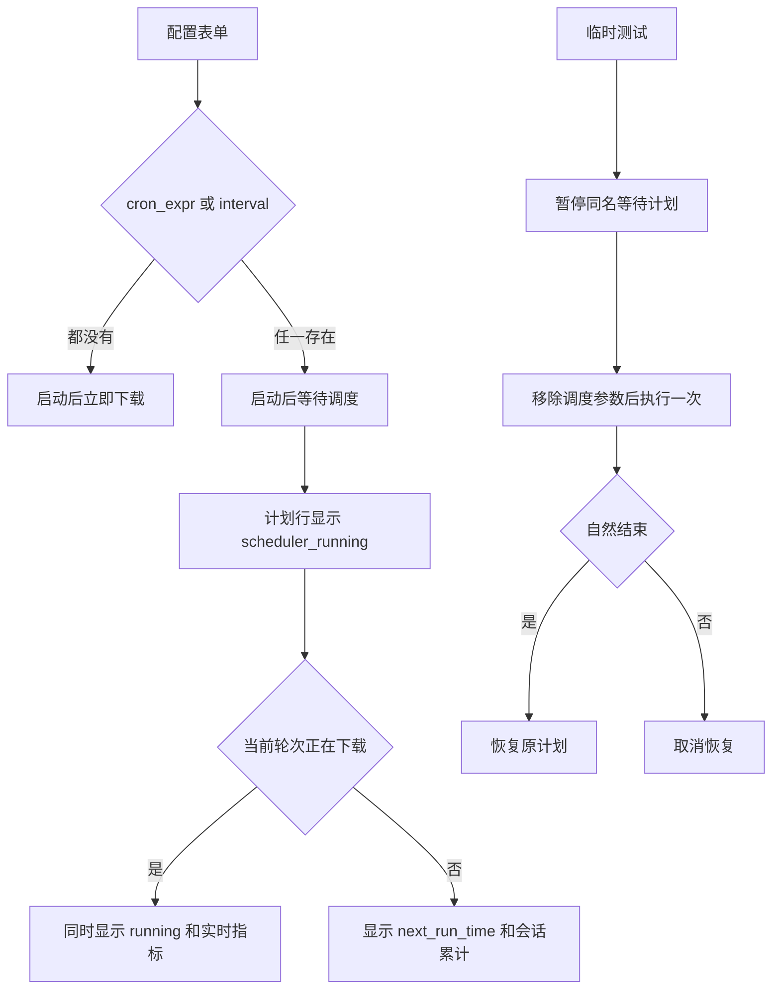

# Traffic Consumer Frontend

Traffic Consumer 的 Web 控制台，基于 Vue 3、TypeScript、Vite、Tailwind v4、shadcn-vue、Vue Query 和 Unovis 构建。构建产物写入 `frontend/dist/`，由 Go HTTP 服务直接托管。

## 本地开发

```bash
npm ci
npm run dev
```

Go 后端默认监听 `http://127.0.0.1:5001`。前端开发服务器只负责界面调试；完整运行态、调度器、配置持久化和日志都来自 Go 服务。

常用脚本：

| 命令 | 说明 |
| --- | --- |
| `npm run dev` | 启动 Vite 开发服务器 |
| `npm run build` | 执行 `vue-tsc -b` 并构建静态产物 |
| `npm run preview` | 预览已构建的前端产物 |
| `npm run api:schema` | 从 Go Huma 服务导出 `src/api/openapi.json` |
| `npm run api:generate` | 重新生成 `src/api/generated/` SDK |

## 运行态数据流



- `GET /api/dashboard` 提供配置列表、运行状态、调度摘要和计划列表。
- `GET /api/activity` 提供日志与通知增量，日志来源包括 `runtime`、`scheduler` 和 `download`。
- `GET /api/plans/{name}` 提供单个计划的配置快照、当前会话汇总和最近历史。
- `POST /api/cron/preview` 返回 Cron 表达式接下来 5 次触发时间。

后端 API 字段变化后运行：

```bash
npm run api:generate
npm run build
```

## 调度界面语义



- 配置包含 `cron_expr` 或 `interval` 时，启动命令进入等待调度状态，不立即下载。
- `cron_expr` 和 `interval` 在前端表单中互斥，Cron 表达式使用五段格式。
- 计划行的 `scheduler_running` 表示计划仍在等待后续触发，`running` 表示当前轮次正在下载。
- `next_run_time` 来自后端调度器计算结果，前端只负责格式化展示。
- 临时测试会暂停同名等待计划，测试自然结束后恢复；停止临时测试或停止调度器会取消恢复。
- 调度等待期间保留当前任务会话累计流量和次数，停止计划后清零，历史记录仍从 `stats.json` 读取。

## 目录说明

| 路径 | 说明 |
| --- | --- |
| `src/api/generated/` | OpenAPI 生成的类型和 SDK |
| `src/api/client.ts` | 统一 API client 配置 |
| `src/api/queries.ts` | Vue Query hooks 和命令 mutation |
| `src/composables/useDashboard.ts` | Dashboard 聚合状态和命令入口 |
| `src/domain/` | 配置表单、计划状态和展示数据投影 |
| `src/components/dashboard/` | Dashboard 业务组件 |
| `src/components/ui/` | shadcn-vue 基础组件 |
| `src/style.css` | Tailwind v4 主题和语义颜色 |

## 质量门禁

```bash
npm run build
```

涉及 Go API、OpenAPI schema 或运行态 payload 的改动，还需要在仓库根目录运行：

```bash
go test ./...
```
